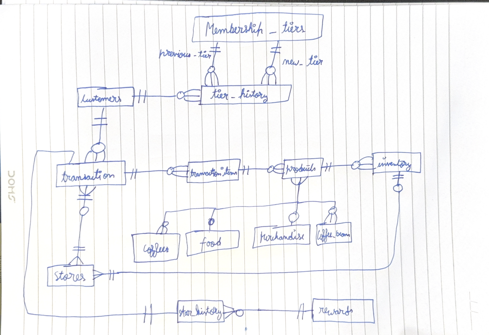

# Starbucks India Loyalty and Store Management System

A SQLite database developed as my final project for Harvard's CS50's Introduction to Databases with SQL.

## Overview

This project simulates a Starbucks India loyalty and store management system. It manages customers, transactions, products, membership tiers, rewards, and inventory.

## Database Features

- 14 tables with primary and foreign keys
- 6 indexes for faster database queries
- 4 triggers for automatic Star tracking, membership upgrades, and inventory management
- 1 view for checking customer Star balances
- Green, Gold, and Reserve membership tiers
- Store sales and product inventory tracking

## Technologies Used

- SQLite

## Project Files

- `schema.sql` — Database tables, indexes, triggers, and view
- `queries.sql` — Example SQL queries
- `starbucks.db` — SQLite database with sample data
- `DESIGN.md` — Database design, relationships, and limitations
- `diagram.png` — Entity relationship diagram

## Entity Relationship Diagram

## How to Run

1. Install SQLite.
2. Download or clone this repository.
3. Open the database using:

   `sqlite3 starbucks.db`

4. Run SQL queries from `queries.sql` to explore the database.

## Author

Veer Sinha
